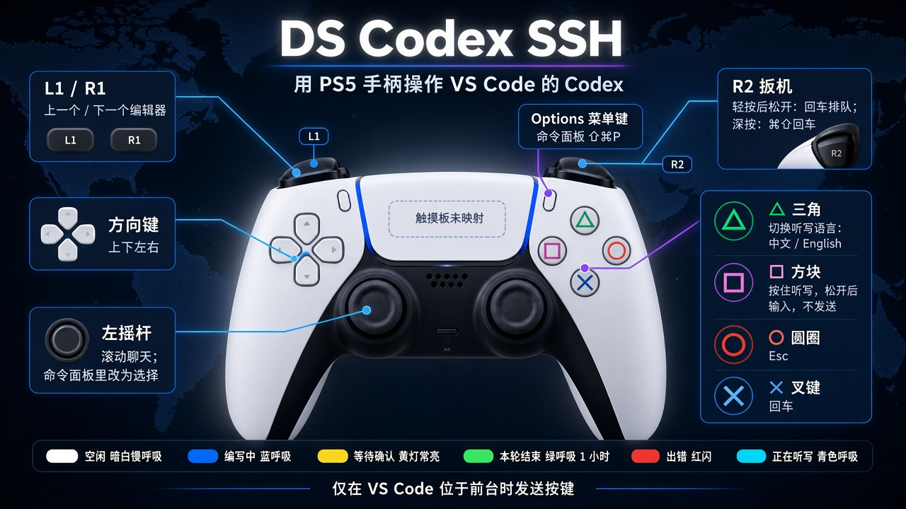

# DS Codex SSH

用 PS5 DualSense 操作 Mac 上的 VS Code，并把远程 Linux 上 Codex 的编程状态显示在手柄灯条上。听写支持中文和 English。



按键只在 VS Code 位于前台时发送。Codex 插件的界面在 Mac 上，所以快捷键打到本机 VS Code 进程。灯条也由本机程序写。Linux 只负责在回合状态变化时，经 SSH 反向转发通知这只程序。

## 构建

需要 macOS 14 或更新版本，以及 Xcode Command Line Tools。

```sh
bash test.sh
bash build.sh "$HOME/Applications/DS Codex SSH.app"
open "$HOME/Applications/DS Codex SSH.app"
```

`test.sh` 只检查按键、灯效和 hook 解析，不连接 Linux，也不需要手柄。

构建使用本机固定签名。辅助功能授权会一直有效，不用每次编译都重新允许。第一次仍要在系统设置里打开 **DS Codex SSH**。如果列表里有好几条同名旧记录，删掉后再打开剩下的那条，然后从菜单退出程序再打开一次。正在运行的程序不会立刻用上刚勾上的权限。

- 辅助功能：向 VS Code 发送按键和滚动
- 输入监控：VS Code 在前台时仍能收到 □。只显示「已连接」不够，菜单还要出现「按键 HID」。没授权时菜单栏会变成「🎮 需要输入监控」
- 麦克风和语音识别：□ 听写

重新编译后如果按键失效，删掉辅助功能里的旧条目再加一次。

使用期间退出其他正在写这只手柄灯条的程序，例如 DS Control、DualSense Codex。

## 启动

这是菜单栏程序，没有 Dock 图标。构建之后用下面的命令打开，或在访达里双击 `DS Codex SSH.app`：

```sh
open "$HOME/Applications/DS Codex SSH.app"
```

还放在项目目录里、没有拷到「应用程序」时：

```sh
open "$PWD/build/DS Codex SSH.app"
```

菜单栏出现 **🎮** 就表示已经在运行。点开它可以看到手柄、辅助功能和监听状态。退出也在这个菜单里，选「退出 DS Codex SSH」。

第一次打开，macOS 可能提示无法验证开发者。在访达里对这个 app **按住 Control 再点「打开」**，确认后再开。不要直接运行包里的 `DSCodexSSH` 可执行文件，系统会因此读不到隐私说明并立刻退出。

## 连接 PS5 手柄

不需要安装索尼驱动，也不需要第三方驱动。macOS 14 自带 DualSense 支持，插上或配对后，菜单从「未连接 DualSense」变成「已连接」即可。

先退出正在占用这只手柄的游戏，以及 DS Control、DualSense Codex。

**插线。** 用能传数据的 USB 线，充电线不行。一头接手柄，一头接 Mac。这是灯条最稳的接法。

**蓝牙。** 手柄关机后，同时按住 **PS 键** 和 **Create 键**（触摸板左侧、三条横线那个）大约三秒，灯条快闪后，到 **系统设置 → 蓝牙** 里连接「DualSense Wireless Controller」。

听写用的是 Mac 当前选中的麦克风，不是手柄上的麦克风。菜单「测试灯效：本轮结束」能直接看灯，这一步不用打开 VS Code。

## 在本机 VS Code 的 Codex 插件里试

这一步不用连 Linux，也不用配 SSH 转发。

1. 菜单栏程序已打开，手柄菜单显示已连接，辅助功能已授权。
2. 打开 VS Code，点开 Codex 侧边栏，用鼠标点一次 Codex 输入框。
3. 按住 **□** 说中文，松开后文字粘贴进 Codex 输入框，不会出现在屏幕底部的系统听写条里。按 **×**，或把 **R2** 轻按后松开，会按回车发送。
4. 按一下 **△**，菜单里的听写语言变成 English，再按住 **□** 说英文。
5. 按 **Options** 应打开命令面板。**○** 是 Esc。

灯不靠系统听写。VS Code 的 Codex 会把回合写进本机 `~/.codex/sessions`。菜单栏程序直接看这份记录：发出消息后灯条变蓝呼吸，回复结束变绿呼吸，并保持 **1 小时**。发一句很短的话就能看到。终端里执行 `curl -sf http://127.0.0.1:8931/health`，看到 `ok` 说明程序在听。灯完全不亮时，先用菜单「测试灯效」确认手柄。

远程 Linux 上的 Codex 才需要 hook。本机插件可以跳过下面的安装，直接看下一节之前的 SSH 说明。

要把 hook 也装上时，放到 **Mac 自己的** `~/.codex`：

```sh
cd /path/to/ds_for_vscode
mkdir -p ~/.codex
cp hooks/codex-light-hook.sh ~/.codex/ds-codex-light.sh
chmod +x ~/.codex/ds-codex-light.sh
```

如果还没有 `~/.codex/hooks.json`，直接复制：

```sh
cp hooks/hooks.json ~/.codex/hooks.json
```

已经有这个文件时，只把 `hooks/hooks.json` 里的几段合并进去，不要覆盖原来的 hook。然后在 Codex 里信任这些新 hook，没信任就不会执行。本机装了 Codex CLI 的话，进 `codex` 后用 `/hooks` 信任；VS Code 里如果弹出审查提示，也要同意。

信任之后，远程回合也会把灯点亮。编写过程中灯条蓝呼吸，这一轮结束变成绿呼吸，保持 1 小时后回到暗白。

远程 Linux 上的 Codex 才需要下一节的 SSH 反向转发。本机插件测试跳过那一节。

## 按键

| 控件 | 作用 |
| --- | --- |
| □ | 按住听写，松开后把文字输入当前焦点。不自动发送 |
| △ | 在中文和 English 之间切换 |
| × | 回车 |
| ○ | Esc |
| Options | 命令面板（Command + Shift + P） |
| 方向键 | 方向键 |
| 左摇杆 | 滚动聊天；命令面板打开时改为选择 |
| L1 / R1 | 上一个 / 下一个编辑器 |
| R2 轻按后松开 | 回车，按 Codex 默认设置是排队发送 |
| R2 深按 | Command + Shift + 回车，对正在跑的任务做一次相反操作 |

先点击 Codex 输入框，再按 R2 或推左摇杆。输入框很高、像代码编辑器时，R2 不会发送，避免把回车打进代码。

Codex 的 Enter 行为请保持默认「Enter 发送」。跟进消息的默认模式是排队；深按 R2 走的是插件文档里的 Command + Shift + Enter。

## 灯

| 状态 | 灯 |
| --- | --- |
| 空闲 | 暗白慢呼吸 |
| 编写中 | 蓝呼吸 |
| 等待确认 | 黄灯常亮，并震一下 |
| 本轮结束 | 绿呼吸 1 小时，两次短震，然后回到空闲 |
| 出错 | 红闪（菜单里可测试） |
| 正在听写 | 青色呼吸，盖过上面的状态 |

菜单里的「测试灯效」不需要 Linux。绿呼吸表示这一轮回复结束，不是代码已经验收通过。

## 接上远程 Codex

程序监听 `127.0.0.1:8931`。在 Mac 的 `~/.ssh/config` 里，给这台 Linux 加上：

```
RemoteForward 127.0.0.1:8931 127.0.0.1:8931
```

菜单「复制 SSH 反向转发」会把这一行放进剪贴板。VS Code 用 Remote SSH 连上之后，Linux 上访问 `127.0.0.1:8931` 会回到 Mac。可以在 Linux 上执行 `curl -sf http://127.0.0.1:8931/health`，看到 `ok` 即表示隧道通了。远程 sshd 需要允许 TCP 转发。

把 hook 装到 **跑 Codex 的那台机器**。Remote SSH 时就是 Linux：

```sh
mkdir -p ~/.codex
# 从 Mac 拷过去，例如：
# scp hooks/codex-light-hook.sh linux:~/.codex/ds-codex-light.sh
chmod +x ~/.codex/ds-codex-light.sh
```

把 `hooks/hooks.json` 合并进 Linux 的 `~/.codex/hooks.json`，保留原来的 hook。然后在 Codex 里信任这些新 hook，否则它们不会运行。脚本只把事件名和会话编号转发给 Mac，立刻输出 `{}`，不会让 Codex 继续多跑一轮，也不保存回复正文。

如果 Codex 的服务进程实际跑在 Mac 上，同一个脚本直接打本机 `8931`，可以不配反向转发。
